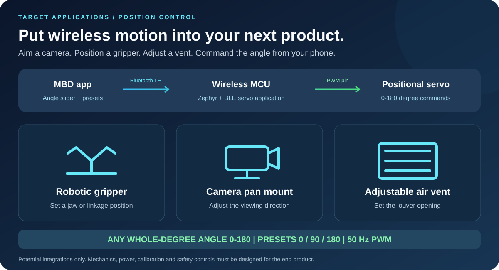
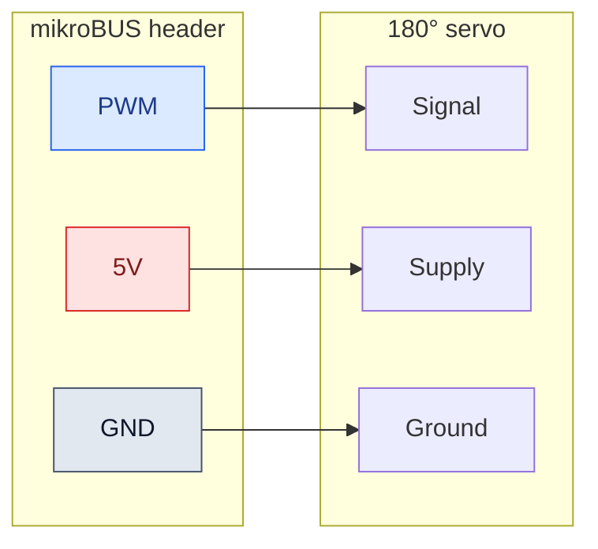
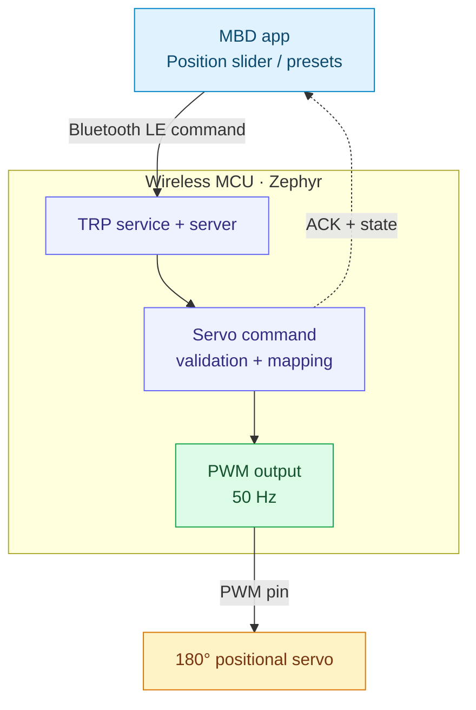
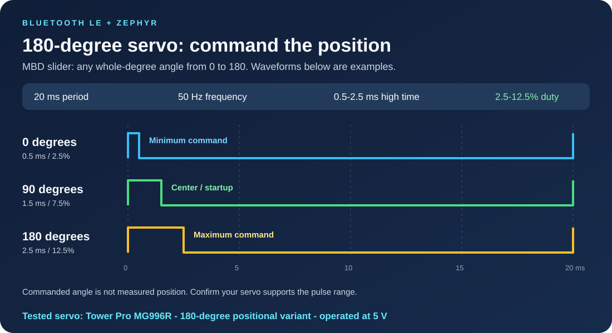
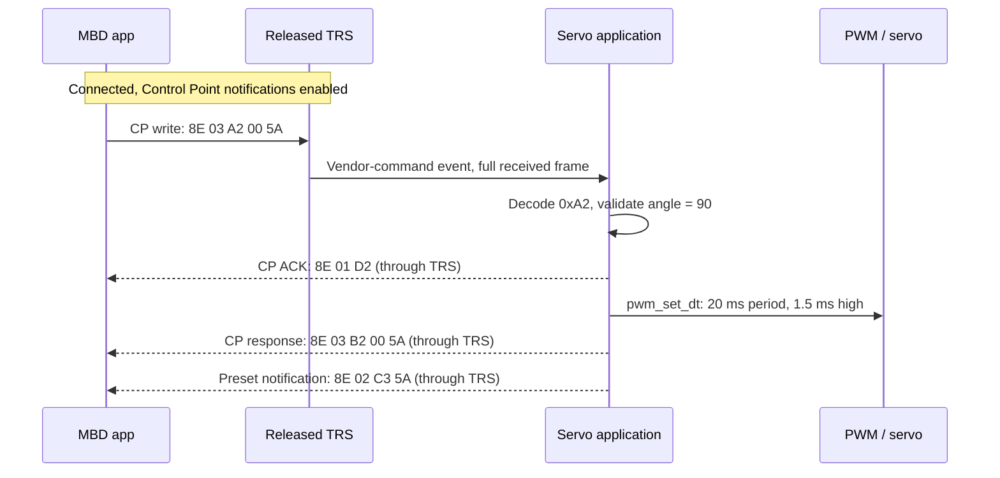

<div align="center">

# Bluetooth LE 180° Servo Motor Control

**Wireless position control. Powered by Zephyr.**

Wireless MCU &nbsp; | &nbsp; Bluetooth LE &nbsp; | &nbsp; 50 Hz PWM &nbsp; | &nbsp; 0–180°

[Set up Zephyr](#2-zephyr-setup-prerequisites) · [Import](#3-import-the-application) · [Build](#7-build-the-application) · [Flash](#8-program-the-board) · [Run with MBD](#9-run-the-demo-with-mbd)

</div>



> **Full-range position control:** Move the MBD slider to command **any whole-degree
> angle from 0° to 180°**, not only the three illustrated positions. The **0°,
> 90°, and 180°** preset buttons provide shortcuts.
>
> **Tested hardware:** Tower Pro **MG996R 180° positional servo**, operated at **5 V**.

## Disclaimer

This example is provided **“AS IS”** as a starting point for development and
self-support. Verify the servo's electrical ratings and mechanical travel before
use. Firmware position values are commands, not measured shaft angles.

[Microchip technical support](https://www.microchip.com/en-us/support) ·
[Companion 360° application](https://github.com/MicrochipTech/Bluetooth_LE_360_Servo_Motor_Control)

## Contents

1. [Introduction and target applications](#1-introduction-and-target-applications)
2. [Zephyr setup prerequisites](#2-zephyr-setup-prerequisites)
3. [Import the application](#3-import-the-application)
4. [Hardware setup](#4-hardware-setup)
5. [Zephyr application configuration](#5-zephyr-application-configuration)
6. [How PWM controls position](#6-how-pwm-controls-position)
7. [Build the application](#7-build-the-application)
8. [Program the board](#8-program-the-board)
9. [Run the demo with MBD](#9-run-the-demo-with-mbd)
10. [BLE commands and data flow](#10-ble-commands-and-data-flow)
11. [Validation and troubleshooting](#11-validation-and-troubleshooting)
12. [Project map and references](#12-project-map-and-references)

## 1. Introduction and target applications

Move a compatible **180° positional servo** wirelessly from the Microchip
Bluetooth Data (MBD) app. The board translates a BLE position command into a
hardware-generated PWM pulse. Change the position continuously with a slider or
select the fixed **0°, 90°, and 180°** commands.

### Potential end products

| Target application | What position control enables |
| :-- | :-- |
| Robotic gripper | Adjust a jaw or linkage to a commanded position |
| Camera pan mount | Change viewing direction within the mechanical travel |
| Adjustable air vent | Set a louver opening from a phone |

These are **integration ideas**, not validated complete products. The demo
controls one servo; product mechanics, calibration, power, and safety controls
must be designed separately.

> [!IMPORTANT]
> A continuous-rotation servo is not a substitute for a positional servo. Use the
> [360° application](https://github.com/MicrochipTech/Bluetooth_LE_360_Servo_Motor_Control)
> for speed, direction, and start/stop control.

## 2. Zephyr setup prerequisites

Complete the [Zephyr Wireless environment setup](https://github.com/Zephyr4Microchip/zephyr-wireless#2-environment-setup)
using either of the two supported workflows:

- **Workbench (VS Code):** Follow the [Workbench for Zephyr guide](https://github.com/Zephyr4Microchip/zephyr-wireless/blob/main/docs/Workbench_for_Zephyr.md).
- **Command line (CLI):** Follow the [command-line setup instructions](https://github.com/Zephyr4Microchip/zephyr-wireless#legacy-command-line).

Use those guides for host tools, workspace and SDK installation, Microchip
libraries, OpenOCD, and programmer-mode setup. Use the TRP revision listed in
[application configuration](#5-zephyr-application-configuration) and SDK **0.17.4**
for this application.

**Supported board:** PIC32-BZ6 Curiosity only — **`pic32wm_bz6204_curiosity`**.

## 3. Import the application

### Clone into the workspace

From an **initialized workspace using the pinned Zephyr checkout**, synchronize
the dependencies and obtain the required Microchip blobs:

```powershell
west update
west blobs fetch hal_microchip
git clone https://github.com/MicrochipTech/Bluetooth_LE_180_Servo_Motor_Control.git applications\Bluetooth_LE_180_Servo_Motor_Control
```

Run these commands in the intended workspace, not an unrelated shared workspace.
Its manifest must refer to the pinned release. The application repository alone
does not contain Zephyr, its modules, or the toolchain.

> [!TIP]
> The branch name alone is not enough: an older local checkout of the same branch
> may not contain the released TRS subsystem. Check the commit and ensure your
> build selects that checkout if multiple Zephyr packages are installed.

### Workbench

Follow [Import existing application in Workbench](https://github.com/Zephyr4Microchip/zephyr-wireless/blob/main/docs/Workbench_for_Zephyr.md#7-import-existing-application).
Select the cloned `applications\Bluetooth_LE_180_Servo_Motor_Control` folder.
Choose board **`pic32wm_bz6204_curiosity`**, SoC qualifier
**`pic32cx2051bz62132`** if requested, and SDK **0.17.4**.

### CLI

No IDE import is required. After cloning, use the application path as the source
argument to `west build` in [Build the application](#7-build-the-application).
See the [Zephyr Wireless CLI workflow](https://github.com/Zephyr4Microchip/zephyr-wireless#legacy-command-line)
for workspace and shell setup.

## 4. Hardware setup

### Bill of materials

| Item | Quantity | Notes |
| :-- | :--: | :-- |
| [PIC32-BZ6 Curiosity board](https://www.microchip.com/en-us/development-tool/ev31u42a) | 1 | Only supported board: `pic32wm_bz6204_curiosity/pic32cx2051bz62132` |
| Tower Pro MG996R 180° positional servo | 1 | Tested at **5 V**; verify the exact unit's supply, signal-level, pulse-range, and current requirements |
| USB data cable | 1 | Board programming and serial connection |
| Jumper wires | 3 | Signal, supply, and ground |
| BLE-capable phone with MBD | 1 | A version supporting the servo command interface |
| Suitable regulated servo supply | As needed | Use an external supply if the board's available current is insufficient |

### Wiring

**The 180° and 360° demos use the same three-wire connection on mikroBUS header 2.**
The setup used here takes PWM, 5 V, and GND from that header.

| PIC32-BZ6 Curiosity connection | Servo connection | Purpose |
| :-- | :-- | :-- |
| **mikroBUS header 2 — PWM** | PWM / signal input | PC11, routed as **TCC1 WO1** |
| **mikroBUS header 2 — 5V** | Servo supply input | Only for a servo rated for 5 V and within the board power budget |
| **mikroBUS header 2 — GND** | Servo ground | Common signal and power reference |



> [!WARNING]
> Check the board and servo current ratings, including servo stall current. Do
> not assume the board's 5 V header can supply every servo. If an external supply
> is required, connect its ground to board ground and avoid tying its output to
> the board's 5 V rail unless the power arrangement explicitly permits it.
> Never connect a 5 V supply to the MCU signal pin.

Connect wiring with power removed. Verify servo pin functions from its datasheet;
wire colors are not a reliable specification. Allow clearance for the startup
move to the center position. Hardware photos can be added alongside these diagrams
without changing the documented pin mapping.

## 5. Zephyr application configuration

This application builds on the **Microchip Transparent Profile (TRP)** available
through [Zephyr Wireless](https://github.com/Zephyr4Microchip/zephyr-wireless),
using the [released Transparent UART sample](https://github.com/Zephyr4Microchip/zephyr/tree/bb83b6cd729c963eb5fee17caa26ef33aba5332a/samples/bluetooth/peripheral_trp_uart).
It uses the TRP service/server for BLE communication and adds the **180° servo
command interface and PWM position control**.

| TRP source baseline | Version / revision |
| :-- | :-- |
| Zephyr version | **4.2.0** |
| Microchip branch | **`mchp_pic32cxbz_v420`** |
| Exact revision used | **`bb83b6cd729c963eb5fee17caa26ef33aba5332a`** |

The TRP revision used here is a branch commit, not a tagged release. The older
`pic32cxbz_v420_v1.2.0` tag does not include this TRP implementation; use the
revision above to reproduce this application.

| At a glance | Application behavior |
| :-- | :-- |
| BLE advertising name | `Zephyr_Servo-180` |
| Servo UI name / type | `SERVO 180` / `0x00` |
| Position range | Integer commands from **0 to 180** |
| Startup command | **90°**, using a 1.5 ms pulse |
| PWM output | **PC11 / TCC1 WO1**, mikroBUS header 2 PWM |
| PWM timing | **20 ms period / 50 Hz**, 0.5–2.5 ms high pulse |
| Mobile transport | TRS Control Point, vendor opcode `0x8E` |
| Feedback | Command ACKs and software-state responses; no external position sensor |



Diagrams show generic functional connections. The hardware table and overlay
define the actual BZ6 pin mapping; no other board is currently supported.

Zephyr uses Kconfig for features, devicetree for routing, and its PWM API for
pulse updates.

| Layer | Configuration / source | Role |
| :-- | :-- | :-- |
| BLE + released TRS | [prj.conf](prj.conf) | Enables Bluetooth peripheral, TRS service/server, dynamic GATT, and buffers |
| Servo type | [Kconfig](Kconfig) | Selects the 180° application |
| PWM route | [BZ6 board overlay](boards/pic32wm_bz6204_curiosity.overlay) | `pwm-servo` alias, TCC1 channel 1, PC11, 20,000,000 ns period |
| Command integration | [main.c](src/main.c) | Advertising, TRS event dispatch, UART bridge, and servo command forwarding |
| Position-to-pulse mapping | [Servo implementation](src/app_servo_motor_180.c) | Range validation, ACKs/responses, and `pwm_set_dt()` |
| Command definitions | [Servo header](src/app_servo_motor_180.h) | Opcodes, request/response IDs, and preset values |

```ini
CONFIG_BT_TRS=y
CONFIG_BT_TRS_SERVER=y
CONFIG_BT_GATT_DYNAMIC_DB=y
CONFIG_GPIO=y
CONFIG_PWM=y
```

BLE is configured for one connection, a target ATT MTU of 247, and
16 TRS receive buffers of 244 bytes. The actual MTU is negotiated with the phone.
Persistent bond storage is not enabled.

## 6. How PWM controls position



### Fixed frequency, variable high time

The timer repeats a pulse every **20 ms**, so:

```text
Frequency = 1 / 0.020 s = 50 Hz
Duty cycle (%) = high pulse width / 20 ms × 100
```

The app sends an **angle**, not a duty-cycle percentage. Firmware converts that
angle to a pulse width and calls `pwm_set_dt()` with a fixed period.

```text
Commanded angle θ: 0 to 180
Pulse width (ns) = 500,000 + floor(θ × 2,000,000 / 180)
Pulse width (ms) ≈ 0.5 + θ / 90
Duty cycle (%) ≈ 2.5 + θ / 18
```

| Position command | High pulse | Duty cycle at 50 Hz | Use |
| --: | --: | --: | :-- |
| **0°** | **0.50 ms** | **2.50%** | Minimum command / fixed preset |
| 45° | 1.00 ms | 5.00% | Intermediate position |
| **90°** | **1.50 ms** | **7.50%** | Startup / center preset |
| 135° | 2.00 ms | 10.00% | Intermediate position |
| **180°** | **2.50 ms** | **12.50%** | Maximum command / fixed preset |

> [!IMPORTANT]
> **A 50 Hz PWM signal does not mean 50% duty cycle.** This application uses
> 2.5–12.5% duty cycle. Servo position is encoded by pulse width. Actual travel
> depends on the servo; confirm that 0.5–2.5 ms is supported before using the
> endpoints. Software does not measure the shaft position.

## 7. Build the application

### Workbench

Follow [Build the application in Workbench](https://github.com/Zephyr4Microchip/zephyr-wireless/blob/main/docs/Workbench_for_Zephyr.md#step8)
using the board and SDK selected during import. Select the pinned Zephyr
checkout documented in [Application configuration](#5-zephyr-application-configuration).

### CLI

Refer to [Zephyr Wireless — Building sample applications](https://github.com/Zephyr4Microchip/zephyr-wireless#3-building-sample-applications).
For this repository, use the following board and source path.

From the workspace root with the pinned checkout selected:

```powershell
west build -b pic32wm_bz6204_curiosity/pic32cx2051bz62132 -d applications\Bluetooth_LE_180_Servo_Motor_Control\build\released applications\Bluetooth_LE_180_Servo_Motor_Control
```

Builds are generated locally under `build/`, which is ignored by Git. No
precompiled image is required from this repository. When switching Zephyr
revisions, use a new build directory or a pristine build; do not flash a stale
image from an earlier configuration.

## 8. Program the board

### Workbench

Follow [Flash the application in Workbench](https://github.com/Zephyr4Microchip/zephyr-wireless/blob/main/docs/Workbench_for_Zephyr.md#step9)
and select the **`openocd`** runner. OpenOCD installation and CMSIS-DAP
programmer-mode switching are covered in the
[setup prerequisite](#2-zephyr-setup-prerequisites), not repeated here.

### CLI

Refer to [West flashing and debugging](https://docs.zephyrproject.org/4.2.0/develop/west/build-flash-debug.html#flashing-west-flash).
Flash the build directory produced in the previous section:

```powershell
west flash -d applications\Bluetooth_LE_180_Servo_Motor_Control\build\released --runner openocd
```

## 9. Run the demo with MBD

The table describes the firmware-facing workflow. Exact MBD menu names and
screenshots depend on the app version and can be added with the demo images.

| Step | Action in the setup / MBD app | Expected firmware behavior |
| :--: | :-- | :-- |
| 1 | Power and reset the programmed board | Servo receives the 90° / 1.5 ms startup command |
| 2 | Open MBD, scan, and connect to **`Zephyr_Servo-180`** | Board establishes one BLE connection |
| 3 | Open the servo controls in a compatible MBD version | UI-update exchange identifies `SERVO 180`, type `0x00`, and current software state |
| 4 | Ensure Control Point notifications are enabled; a compatible app may manage this automatically | ACKs and servo responses can reach the phone |
| 5 | Adjust the position slider within **0–180** | Firmware maps the angle to a 0.5–2.5 ms pulse |
| 6 | Select **0°, 90°, or 180°** | Firmware updates position and returns state information |
| 7 | Observe the servo and compare with serial logs if needed | Commanded position and pulse width are logged |

For a manual BLE client, enable Control Point notifications **before** sending
commands. Use hexadecimal byte writes, not ASCII text. The UI-update request is
`8E 01 A1`; a 90° slider request is `8E 03 A2 00 5A`.

> [!NOTE]
> A generic UART text terminal is not the MBD servo interface. Writing to the TRS
> RX data characteristic forwards bytes to UART; it does **not** execute a servo
> command. Servo commands belong on the **Control Point** characteristic.

## 10. BLE commands and data flow

### From a slider action to the PWM pin



ACK means the request reached the application path; it is **not** physical
position feedback or proof that the PWM hardware succeeded. Check errors and the
actual servo movement during validation.

### Transport channels

| Characteristic | Phone action | Board action |
| :-- | :-- | :-- |
| **Control Point (CP)** | Write servo frames; subscribe for responses | Executes `0x8E` commands; sends ACKs, responses, and CBFC messages |
| **RX data** | Write transparent bytes | Forwards bytes to UART TX |
| **TX data** | Subscribe to notifications | Delivers UART-originated transparent data |

<details>
<summary><strong>GATT UUIDs and advertising identity</strong></summary>

| Item | Value |
| :-- | :-- |
| TRS service | `49535343-FE7D-4AE5-8FA9-9FAFD205E455` |
| TX characteristic | `49535343-1E4D-4BD9-BA61-23C647249616` |
| RX characteristic | `49535343-8841-43F4-A8D4-ECBE34729BB3` |
| Control Point characteristic | `49535343-4C8A-39B3-2F49-511CFF073B7E` |
| Advertising service-data bytes | `DA FE FF E1` |

Discover characteristics by UUID rather than relying on fixed ATT handles.

</details>

### Servo packet format

All examples below are **hexadecimal bytes on the BLE Control Point**:

```text
 Byte 0       Byte 1             Byte 2        Bytes 3...
+----------+------------------+-------------+-------------------+
| 8E       | LENGTH           | COMMAND ID  | COMMAND DATA      |
+----------+------------------+-------------+-------------------+
 Servo       Bytes after        A1 / A2 /     Position or angle
 opcode      LENGTH             A3
```

The slider angle is an unsigned **16-bit big-endian** value: high byte first.
Fixed-position requests use a **single-byte** angle.

| Phone request | Raw request example | ACK | Main response |
| :-- | :-- | :-- | :-- |
| Read UI / state | `8E 01 A1` | `8E 01 D1` | `0xB1` UI response |
| Slider → 0° | `8E 03 A2 00 00` | `8E 01 D2` | `8E 03 B2 00 00` |
| Slider → 90° | `8E 03 A2 00 5A` | `8E 01 D2` | `8E 03 B2 00 5A` |
| Slider → 180° | `8E 03 A2 00 B4` | `8E 01 D2` | `8E 03 B2 00 B4` |
| Fixed position → 0° | `8E 02 A3 00` | `8E 01 D3` | `8E 02 B3 00` |
| Fixed position → 90° | `8E 02 A3 5A` | `8E 01 D3` | `8E 02 B3 5A` |
| Fixed position → 180° | `8E 02 A3 B4` | `8E 01 D3` | `8E 02 B3 B4` |

A fixed-position request also sends a `0xC2` slider notification. A slider
request equal to 0, 90, or 180 sends a `0xC3` fixed-position notification.

<details>
<summary><strong>UI response layout and initial example</strong></summary>

```text
8E | LENGTH | B1 | NAME_LENGTH | NAME bytes | TYPE | ANGLE_H | ANGLE_L | FIXED_POSITION
```

Initial state (`SERVO 180`, type 0, angle 90, preset 90):

```text
8E 0F B1 09 53 45 52 56 4F 20 31 38 30 00 00 5A 5A
```

State fields report software state, not a sensor measurement. The fixed-position
field tracks the last preset state; an intermediate slider angle does not
necessarily update it.

</details>

### Optional UART bridge

| Input / condition | Behavior |
| :-- | :-- |
| UART text ending in CR or LF | Sent over TX data notifications, without the delimiter |
| UART hex line starting with `8E` | Decoded and sent to the phone through CP; not executed locally as a servo command |
| UART line limit | 128 characters; four completed lines can be queued |
| Oversize line / queue overflow | Line discarded or dropped with a log message |
| UART-to-BLE payload size | Up to `ATT MTU - 4`: 19 bytes at MTU 23; 243 bytes at MTU 247 |
| Temporary TX backpressure | Pending UART data retried; TX-open and CBFC-credit events restart the pump |

## 11. Validation and troubleshooting

**The migrated application has been built, flashed, and reported working on
PIC32-BZ6 hardware.** This is a functional result, not a claim that every stress
or boundary case below has been tested.

| Check | Expected result |
| :-- | :-- |
| Startup | Center command, 1.5 ms pulse |
| Slider 0 / 90 / 180 | 0.5 / 1.5 / 2.5 ms pulse commands |
| Three presets | Correct request, ACK, response, and linked UI notification |
| Reconnect | Device can be rediscovered and commands resume |
| UART / BLE traffic | Correct direction, no unintended servo execution from RX data |
| Extended tests | Verify MTU limits, notification toggles, CBFC replenishment, and burst traffic |

| Symptom | Check |
| :-- | :-- |
| Device not visible | Correct image, power, Bluetooth permissions, and advertising name |
| Connects but controls do nothing | Compatible MBD interface, CP writes, and CP notification subscription |
| Generic UART text has no servo effect | Use the CP command frames, not the RX transparent-data channel |
| Resets or erratic movement | Power/current budget, common ground, supply droop, and loose wiring |
| Angle does not match the label | Servo calibration and supported pulse range; no shaft feedback is available |
| Servo strains at an endpoint | Disconnect power and verify its safe travel/pulse limits |
| Missing UART data | Delimiters, connection/subscription state, queue-overflow logs, and flow control |

> [!WARNING]
> Disconnecting BLE does not disable PWM or recenter the servo. The last pulse
> command remains active. Do not treat radio disconnection as a hardware stop.

## 12. Project map and references

```text
Bluetooth_LE_180_Servo_Motor_Control/
|-- README.md
|-- CMakeLists.txt
|-- Kconfig
|-- prj.conf
|-- sample.yaml
|-- boards/
|   `-- pic32wm_bz6204_curiosity.overlay
|-- docs/
|   |-- target-applications.svg
|   `-- pwm-position.svg
`-- src/
    |-- main.c
    |-- app_servo_motor_180.c
    `-- app_servo_motor_180.h
```

This application supports only the PIC32-BZ6 Curiosity board.

- [Released Transparent UART sample](https://github.com/Zephyr4Microchip/zephyr/tree/bb83b6cd729c963eb5fee17caa26ef33aba5332a/samples/bluetooth/peripheral_trp_uart)
- [Microchip Workbench for Zephyr guide](https://github.com/Zephyr4Microchip/zephyr-wireless/blob/main/docs/Workbench_for_Zephyr.md) — setup, CMSIS-DAP switching, import, build, and flash.
- [Released TRS subsystem](https://github.com/Zephyr4Microchip/zephyr/tree/bb83b6cd729c963eb5fee17caa26ef33aba5332a/subsys/bluetooth/services/trs)
- [Zephyr PWM API](https://docs.zephyrproject.org/4.2.0/hardware/peripherals/pwm.html)
- [Microchip Transparent UART testing guide](https://onlinedocs.microchip.com/oxy/GUID-A5330D3A-9F51-4A26-B71D-8503A493DF9C-en-US-11/GUID-07EC83B7-CC28-4C55-8634-4B7F56A9DB36.html)
