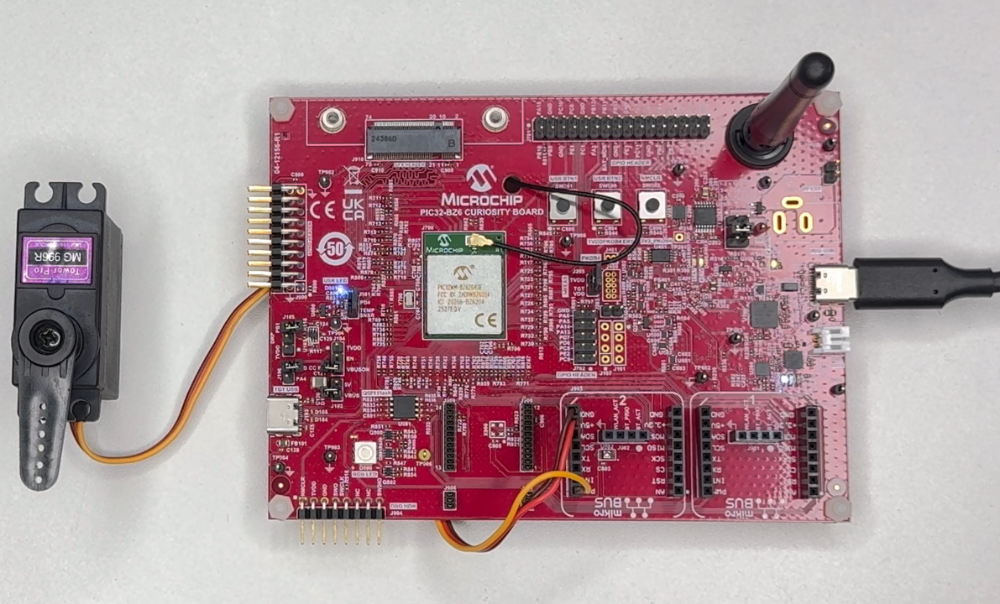
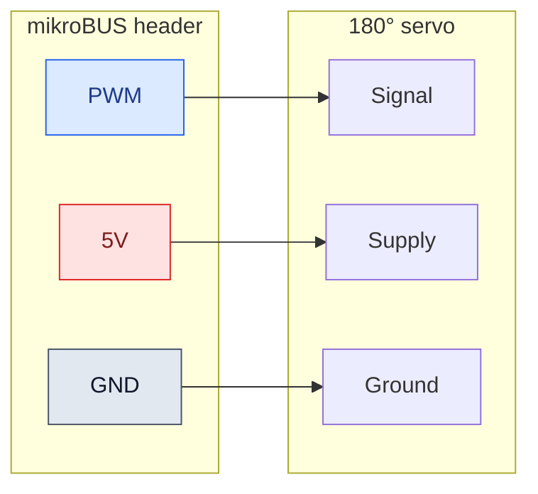
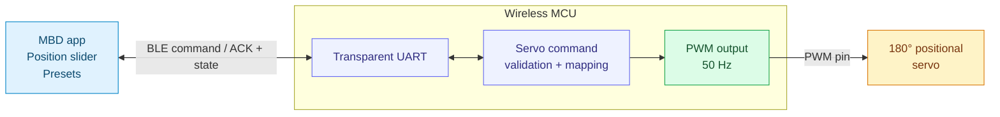
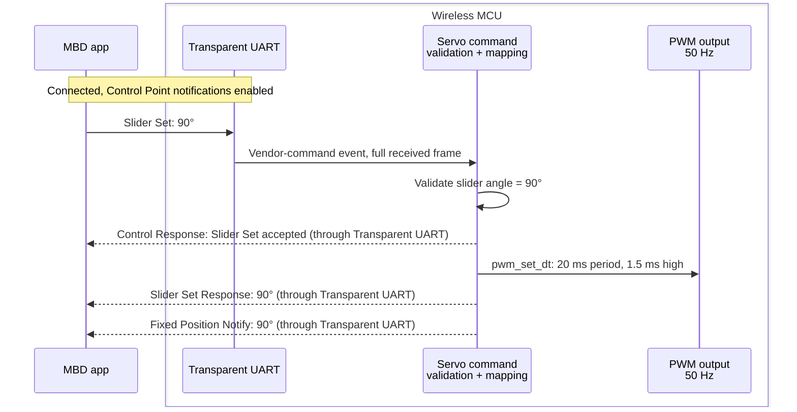

<div align="center">

<h1>Bluetooth LE 180° Servo Motor Control</h1>

<p><strong>Wireless position control. Powered by Zephyr.</strong></p>

<p>Wireless MCU &nbsp; | &nbsp; Bluetooth LE &nbsp; | &nbsp; 50 Hz PWM &nbsp; | &nbsp; 0–180°</p>

<p><a href="#31-prerequisites">Set up Zephyr</a> · <a href="#32-import-the-application">Import</a> · <a href="#34-build-the-application">Build</a> · <a href="#35-program-the-board">Flash</a> · <a href="#5-demo-setup-and-operation">Run with MBD</a></p>

</div>

**Contents**

1. [Introduction](#1-introduction)
2. [Hardware Setup](#2-hardware-setup)
3. [Zephyr Software Setup](#3-zephyr-software-setup)
   - [Prerequisites](#31-prerequisites)
   - [Import the application](#32-import-the-application)
   - [Application configuration](#33-application-configuration)
   - [Build](#34-build-the-application)
   - [Program](#35-program-the-board)
   - [File structure](#36-file-structure)
4. [Application Architecture and Control Principles](#4-application-architecture-and-control-principles)
   - [Control architecture](#41-control-architecture)
   - [BLE data flow and commands](#42-ble-data-flow-and-commands)
   - [PWM and motor control](#43-pwm-and-motor-control)
5. [Demo Setup and Operation](#5-demo-setup-and-operation)
6. [Validation and Troubleshooting](#6-validation-and-troubleshooting)


## 1. Introduction

Move a compatible **180° positional servo** wirelessly from the Microchip
Bluetooth Data (MBD) app. The board translates a BLE position command into a
hardware-generated PWM pulse. Change the position continuously with a slider or
select the fixed **0°, 90°, and 180°** commands.

> **Full-range position control:** Move the MBD slider to command **any whole-degree
> angle from 0° to 180°**, not only the three preset positions. The **0°,
> 90°, and 180°** preset buttons provide shortcuts.
>
> **Tested hardware:** Tower Pro **MG996R 180° positional servo**, operated at **5 V**.

### Disclaimer

This example is provided **“AS IS”** as a starting point for development and
self-support. Verify the servo's electrical ratings and mechanical travel before
use. Firmware position values are commands, not measured shaft angles.

## 2. Hardware Setup

### Bill of materials

| Item | Quantity | Notes |
| :-- | :--: | :-- |
| [PIC32-BZ6 Curiosity board](https://www.microchip.com/en-us/development-tool/ev31u42a) | 1 | Only supported board: `pic32wm_bz6204_curiosity/pic32cx2051bz62132` |
| [Tower Pro MG996R 180° positional servo](https://a.co/d/08a5AwRD) | 1 | Tested at **5 V**; verify the exact unit's supply, signal-level, pulse-range, and current requirements |

> 📌 **Important — Servo power supply**
>
> Use a suitable regulated external servo supply if the board's available current
> is insufficient. Verify the servo's current requirements, including stall
> current, and connect the external supply ground to board ground.

### Wiring

**Connect the 180° positional servo to mikroBUS header 2 as shown below.**
The setup used here takes PWM, 5 V, and GND from that header.

<p align="center"></p>

| PIC32-BZ6 Curiosity connection | Servo connection | Purpose |
| :-- | :-- | :-- |
| **mikroBUS header 2 — PWM** | PWM / signal input | PC11, routed as **TCC1 WO1** |
| **mikroBUS header 2 — 5V** | Servo supply input | Only for a servo rated for 5 V and within the board power budget |
| **mikroBUS header 2 — GND** | Servo ground | Common signal and power reference |



> ⚠️ **Warning**
>
> Check the board and servo current ratings, including servo stall current. Do
> not assume the board's 5 V header can supply every servo. If an external supply
> is required, connect its ground to board ground and avoid tying its output to
> the board's 5 V rail unless the power arrangement explicitly permits it.
> Never connect a 5 V supply to the MCU signal pin.

Connect wiring with power removed. Verify servo pin functions from its datasheet;
wire colors are not a reliable specification. Allow clearance for the startup
move to the center position. Hardware photos can be added alongside these diagrams
without changing the documented pin mapping.

## 3. Zephyr Software Setup

### 3.1 Prerequisites

Complete the [Zephyr Wireless environment setup](https://github.com/Zephyr4Microchip/zephyr-wireless#2-environment-setup)
using either of the two supported workflows:

- **Workbench (VS Code):** Follow the [Workbench for Zephyr guide](https://github.com/Zephyr4Microchip/zephyr-wireless/blob/main/docs/Workbench_for_Zephyr.md).
- **Command line (CLI):** Follow the [command-line setup instructions](https://github.com/Zephyr4Microchip/zephyr-wireless#legacy-command-line).

Use those guides for host tools, workspace and SDK installation, Microchip
libraries, OpenOCD, and programmer-mode setup. Use a Zephyr checkout containing
the released Transparent UART service/server and SDK **0.17.4** for this
application.

**Supported board:** PIC32-BZ6 Curiosity only — **`pic32wm_bz6204_curiosity`**.

#### Setup guide and supporting references

Complete the environment setup before importing the application. The Transparent
UART, PWM, and testing links below are supporting references, not extra
installation steps.

- [Microchip Workbench for Zephyr guide](https://github.com/Zephyr4Microchip/zephyr-wireless/blob/main/docs/Workbench_for_Zephyr.md) — setup, CMSIS-DAP switching, import, build, and flash.
- [Transparent UART sample](https://github.com/Zephyr4Microchip/zephyr/tree/bb83b6cd729c963eb5fee17caa26ef33aba5332a/samples/bluetooth/peripheral_trp_uart) — application baseline.
- [Transparent UART service and server](https://github.com/Zephyr4Microchip/zephyr/tree/bb83b6cd729c963eb5fee17caa26ef33aba5332a/subsys/bluetooth/services/trs) — BLE implementation.
- [Zephyr PWM API](https://docs.zephyrproject.org/4.2.0/hardware/peripherals/pwm.html) — pulse-generation API used by the servo application.
- [Microchip Transparent UART testing guide](https://onlinedocs.microchip.com/oxy/GUID-A5330D3A-9F51-4A26-B71D-8503A493DF9C-en-US-11/GUID-07EC83B7-CC28-4C55-8634-4B7F56A9DB36.html) — transport testing reference.

### 3.2 Import the application

#### Clone into the workspace

After completing the setup prerequisites, clone the application from your
workspace's `applications` directory:

```powershell
git clone https://github.com/MicrochipTech/Bluetooth_LE_180_Servo_Motor_Control.git
```

Run these commands in the intended workspace, not an unrelated shared workspace.
The application repository alone
does not contain Zephyr, its modules, or the toolchain.

> 💡 **Tip**
>
> The branch name alone is not enough: an older local checkout of the same branch
> may not contain the released Transparent UART service/server. Check the commit
> and ensure your build selects that checkout if multiple Zephyr packages are
> installed.

#### Workbench

Follow [Import existing application in Workbench](https://github.com/Zephyr4Microchip/zephyr-wireless/blob/main/docs/Workbench_for_Zephyr.md#7-import-existing-application).
Select the cloned `applications\Bluetooth_LE_180_Servo_Motor_Control` folder.
Choose board **`pic32wm_bz6204_curiosity`**, SoC qualifier
**`pic32cx2051bz62132`** if requested, and SDK **0.17.4**.

#### CLI

No IDE import is required. For this CLI workflow, copy the application folder or
clone the repository inside the Zephyr checkout's `samples` directory. The build
commands below assume it is at
`~/zephyrproject/zephyr/samples/Bluetooth_LE_180_Servo_Motor_Control`.

To clone it directly into that location:

```bash
cd ~/zephyrproject/zephyr/samples
git clone https://github.com/MicrochipTech/Bluetooth_LE_180_Servo_Motor_Control.git
```

See the [Zephyr Wireless CLI workflow](https://github.com/Zephyr4Microchip/zephyr-wireless#legacy-command-line)
for workspace and shell setup.

### 3.3 Application configuration

This application builds on **Transparent UART** available
through [Zephyr Wireless](https://github.com/Zephyr4Microchip/zephyr-wireless),
using the [Transparent UART sample](https://github.com/Zephyr4Microchip/zephyr/tree/bb83b6cd729c963eb5fee17caa26ef33aba5332a/samples/bluetooth/peripheral_trp_uart).
It uses the Transparent UART service/server for BLE communication and adds the
**180° servo command interface and PWM position control**.

Zephyr uses Kconfig for features, devicetree for routing, and its PWM API for
pulse updates.

| Layer | Configuration / source | Role |
| :-- | :-- | :-- |
| BLE + Transparent UART | [prj.conf](prj.conf) | Enables the Bluetooth peripheral, Transparent UART service/server, dynamic GATT, and buffers |
| Servo type | [Kconfig](Kconfig) | Selects the 180° application |
| PWM route | [BZ6 board overlay](boards/pic32wm_bz6204_curiosity.overlay) | `pwm-servo` alias, TCC1 channel 1, PC11, 20,000,000 ns period |
| Command integration | [main.c](src/main.c) | Advertising, Transparent UART event dispatch and serial bridge, and servo command forwarding |
| Position-to-pulse mapping | [Servo implementation](src/app_servo_motor_180.c) | Range validation, ACKs/responses, and `pwm_set_dt()` |
| Command definitions | [Servo header](src/app_servo_motor_180.h) | Opcodes, request/response IDs, and preset values |

The configuration enables the Bluetooth peripheral, Transparent UART
service/server, dynamic GATT database, GPIO, and PWM.

BLE is configured for one connection, a target ATT MTU of 247, and
16 Transparent UART receive buffers of 244 bytes. The actual MTU is negotiated
with the phone.
Persistent bond storage is not enabled.

### 3.4 Build the application

#### Workbench

Follow [Build the application in Workbench](https://github.com/Zephyr4Microchip/zephyr-wireless/blob/main/docs/Workbench_for_Zephyr.md#step8)
using the board and SDK selected during import. Select a Zephyr checkout
containing the released Transparent UART service/server.

#### CLI

Refer to [Zephyr Wireless — Building sample applications](https://github.com/Zephyr4Microchip/zephyr-wireless#3-building-sample-applications).
For this repository, use the following board and source path.

From the Zephyr checkout directory:

```bash
cd ~/zephyrproject/zephyr
west build -p always -b pic32wm_bz6204_curiosity/pic32cx2051bz62132 samples/Bluetooth_LE_180_Servo_Motor_Control
```

The build output is generated under `build/`. No precompiled image is required
from this repository.

### 3.5 Program the board

#### Workbench

Follow [Flash the application in Workbench](https://github.com/Zephyr4Microchip/zephyr-wireless/blob/main/docs/Workbench_for_Zephyr.md#step9)
and select the **`openocd`** runner. OpenOCD installation and CMSIS-DAP
programmer-mode switching are covered in the
[setup prerequisite](#31-prerequisites), not repeated here.

#### CLI

From the Zephyr checkout directory, flash the build produced in the previous
section:

```bash
cd ~/zephyrproject/zephyr
west flash
```

### 3.6 File structure

```text
Bluetooth_LE_180_Servo_Motor_Control/
|-- README.md
|-- CMakeLists.txt
|-- Kconfig
|-- prj.conf
|-- sample.yaml
|-- boards/
|   `-- pic32wm_bz6204_curiosity.overlay
|-- docs/
|   `-- pwm-position.svg
`-- src/
    |-- main.c
    |-- app_servo_motor_180.c
    `-- app_servo_motor_180.h
```

## 4. Application Architecture and Control Principles

### 4.1 Control architecture

| At a glance | Application behavior |
| :-- | :-- |
| BLE advertising name | `Zephyr_Servo-180` |
| Servo UI name / type | `SERVO 180` / `0x00` |
| Position range | Integer commands from **0 to 180** |
| Startup command | **90°**, using a 1.5 ms pulse |
| PWM output | **PC11 / TCC1 WO1**, mikroBUS header 2 PWM |
| PWM timing | **20 ms period / 50 Hz**, 0.5–2.5 ms high pulse |
| Mobile transport | Transparent UART Control Point, vendor opcode `0x8E` |
| Feedback | Command ACKs and software-state responses; no external position sensor |



Diagrams show generic functional connections. The hardware table and overlay
define the actual BZ6 pin mapping; no other board is currently supported.

### 4.2 BLE data flow and commands

#### From a slider action to the PWM pin



ACK means the request reached the application path; it is **not** physical
position feedback or proof that the PWM hardware succeeded. Check errors and the
actual servo movement during validation.

#### Transport channels

| Characteristic | Phone action | Board action |
| :-- | :-- | :-- |
| **Control Point (CP)** | Write servo frames; subscribe for responses | Executes `0x8E` commands; sends ACKs, responses, and CBFC messages |
| **RX data** | Write transparent bytes | Forwards bytes to UART TX |
| **TX data** | Subscribe to notifications | Delivers UART-originated transparent data |

<details>
<summary><strong>GATT UUIDs and advertising identity</strong></summary>

| Item | Value |
| :-- | :-- |
| Transparent UART service | `49535343-FE7D-4AE5-8FA9-9FAFD205E455` |
| TX characteristic | `49535343-1E4D-4BD9-BA61-23C647249616` |
| RX characteristic | `49535343-8841-43F4-A8D4-ECBE34729BB3` |
| Control Point characteristic | `49535343-4C8A-39B3-2F49-511CFF073B7E` |
| Advertising service-data bytes | `DA FE FF E1` |

Discover characteristics by UUID rather than relying on fixed ATT handles.

</details>

#### Servo packet format

All examples below are **hexadecimal bytes on the BLE Control Point**:

```text
 Byte 0       Byte 1             Byte 2        Bytes 3...
+----------+------------------+-------------+-------------------+
| 8E       | LENGTH           | COMMAND ID  | COMMAND DATA      |
+----------+------------------+-------------+-------------------+
 Servo       Bytes after        A1 / A2 /     Position or angle
 opcode      LENGTH             A3
```

The slider angle is an unsigned **16-bit big-endian** value: high byte first.
Fixed-position requests use a **single-byte** angle.

| Phone request | Raw request example | ACK | Main response |
| :-- | :-- | :-- | :-- |
| Read UI / state | `8E 01 A1` | `8E 01 D1` | `0xB1` UI response |
| Slider → 0° | `8E 03 A2 00 00` | `8E 01 D2` | `8E 03 B2 00 00` |
| Slider → 90° | `8E 03 A2 00 5A` | `8E 01 D2` | `8E 03 B2 00 5A` |
| Slider → 180° | `8E 03 A2 00 B4` | `8E 01 D2` | `8E 03 B2 00 B4` |
| Fixed position → 0° | `8E 02 A3 00` | `8E 01 D3` | `8E 02 B3 00` |
| Fixed position → 90° | `8E 02 A3 5A` | `8E 01 D3` | `8E 02 B3 5A` |
| Fixed position → 180° | `8E 02 A3 B4` | `8E 01 D3` | `8E 02 B3 B4` |

A fixed-position request also sends a `0xC2` slider notification. A slider
request equal to 0, 90, or 180 sends a `0xC3` fixed-position notification.

<details>
<summary><strong>UI response layout and initial example</strong></summary>

```text
8E | LENGTH | B1 | NAME_LENGTH | NAME bytes | TYPE | ANGLE_H | ANGLE_L | FIXED_POSITION
```

Initial state (`SERVO 180`, type 0, angle 90, preset 90):

```text
8E 0F B1 09 53 45 52 56 4F 20 31 38 30 00 00 5A 5A
```

State fields report software state, not a sensor measurement. The fixed-position
field tracks the last preset state; an intermediate slider angle does not
necessarily update it.

</details>

#### Optional UART bridge

| Input / condition | Behavior |
| :-- | :-- |
| UART text ending in CR or LF | Sent over TX data notifications, without the delimiter |
| UART hex line starting with `8E` | Decoded and sent to the phone through CP; not executed locally as a servo command |
| UART line limit | 128 characters; four completed lines can be queued |
| Oversize line / queue overflow | Line discarded or dropped with a log message |
| UART-to-BLE payload size | Up to `ATT MTU - 4`: 19 bytes at MTU 23; 243 bytes at MTU 247 |
| Temporary TX backpressure | Pending UART data retried; TX-open and CBFC-credit events restart the pump |

### 4.3 PWM and motor control

#### How PWM controls position


##### Fixed frequency, variable high time

The timer repeats a pulse every **20 ms**, so:

```text
Frequency = 1 / 0.020 s = 50 Hz
Duty cycle (%) = high pulse width / 20 ms × 100
```

The app sends an **angle**, not a duty-cycle percentage. Firmware converts that
angle to a pulse width and calls `pwm_set_dt()` with a fixed period.

```text
Commanded angle θ: 0 to 180
Pulse width (ns) = 500,000 + floor(θ × 2,000,000 / 180)
Pulse width (ms) ≈ 0.5 + θ / 90
Duty cycle (%) ≈ 2.5 + θ / 18
```

| Position command | High pulse | Duty cycle at 50 Hz | Use |
| --: | --: | --: | :-- |
| **0°** | **0.50 ms** | **2.50%** | Minimum command / fixed preset |
| 45° | 1.00 ms | 5.00% | Intermediate position |
| **90°** | **1.50 ms** | **7.50%** | Startup / center preset |
| 135° | 2.00 ms | 10.00% | Intermediate position |
| **180°** | **2.50 ms** | **12.50%** | Maximum command / fixed preset |

> 📌 **Important**
>
> **A 50 Hz PWM signal does not mean 50% duty cycle.** This application uses
> 2.5–12.5% duty cycle. Servo position is encoded by pulse width. Actual travel
> depends on the servo; confirm that 0.5–2.5 ms is supported before using the
> endpoints. Software does not measure the shaft position.

## 5. Demo Setup and Operation

The demo below shows the 180° servo responding to wireless position commands.

https://github.com/user-attachments/assets/b8110a87-105f-4725-b334-e7c6fc5fdc61

| Step | Action in the setup / MBD app | Expected firmware behavior |
| :--: | :-- | :-- |
| 1 | Power and reset the programmed board | Servo receives the 90° / 1.5 ms startup command |
| 2 | Open MBD, scan, and connect to **`Zephyr_Servo-180`** | Board establishes one BLE connection |
| 3 | Open the servo controls in a compatible MBD version | UI-update exchange identifies `SERVO 180`, type `0x00`, and current software state |
| 4 | Ensure Control Point notifications are enabled; a compatible app may manage this automatically | ACKs and servo responses can reach the phone |
| 5 | Adjust the position slider within **0–180** | Firmware maps the angle to a 0.5–2.5 ms pulse |
| 6 | Select **0°, 90°, or 180°** | Firmware updates position and returns state information |
| 7 | Observe the servo and compare with serial logs if needed | Commanded position and pulse width are logged |

For a manual BLE client, enable Control Point notifications **before** sending
commands. Use hexadecimal byte writes, not ASCII text. The UI-update request is
`8E 01 A1`; a 90° slider request is `8E 03 A2 00 5A`.

> ℹ️ **Note**
>
> A generic UART text terminal is not the MBD servo interface. Writing to the
> Transparent UART RX data characteristic forwards bytes to UART; it does **not** execute a servo
> command. Servo commands belong on the **Control Point** characteristic.

## 6. Validation and Troubleshooting

**The migrated application has been built, flashed, and reported working on
PIC32-BZ6 hardware.** This is a functional result, not a claim that every stress
or boundary case below has been tested.

| Check | Expected result |
| :-- | :-- |
| Startup | Center command, 1.5 ms pulse |
| Slider 0 / 90 / 180 | 0.5 / 1.5 / 2.5 ms pulse commands |
| Three presets | Correct request, ACK, response, and linked UI notification |
| Reconnect | Device can be rediscovered and commands resume |
| UART / BLE traffic | Correct direction, no unintended servo execution from RX data |
| Extended tests | Verify MTU limits, notification toggles, CBFC replenishment, and burst traffic |

| Symptom | Check |
| :-- | :-- |
| Device not visible | Correct image, power, Bluetooth permissions, and advertising name |
| Connects but controls do nothing | Compatible MBD interface, CP writes, and CP notification subscription |
| Generic UART text has no servo effect | Use the CP command frames, not the RX transparent-data channel |
| Resets or erratic movement | Power/current budget, common ground, supply droop, and loose wiring |
| Angle does not match the label | Servo calibration and supported pulse range; no shaft feedback is available |
| Servo strains at an endpoint | Disconnect power and verify its safe travel/pulse limits |
| Missing UART data | Delimiters, connection/subscription state, queue-overflow logs, and flow control |

> ⚠️ **Warning**
>
> Disconnecting BLE does not disable PWM or recenter the servo. The last pulse
> command remains active. Do not treat radio disconnection as a hardware stop.
